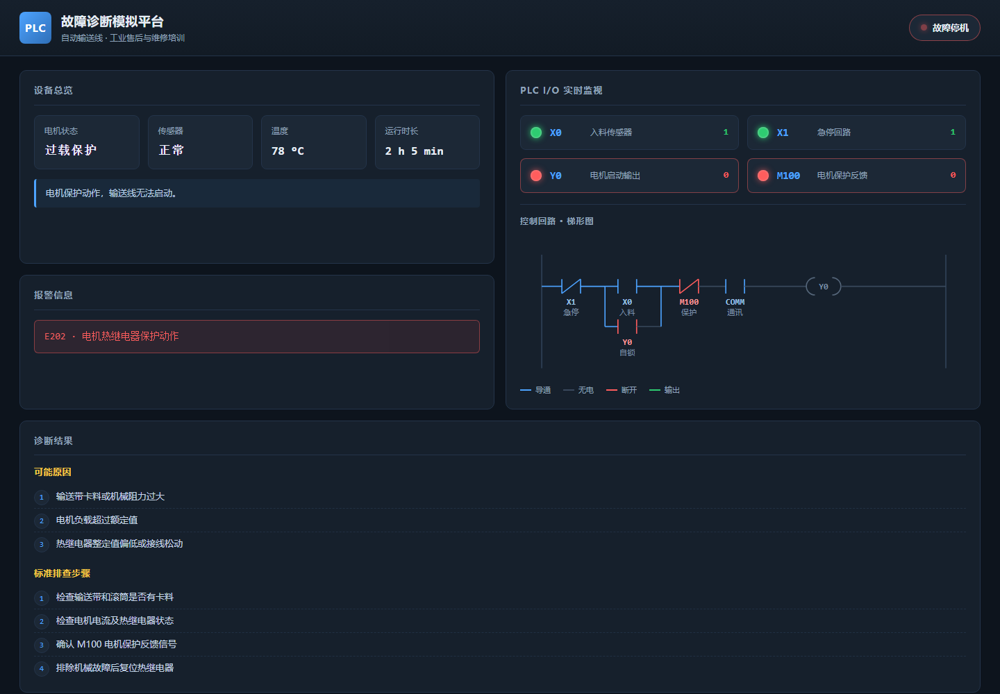
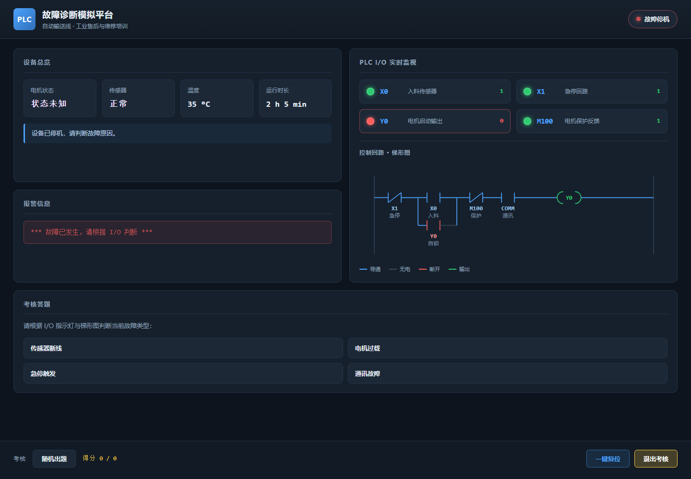
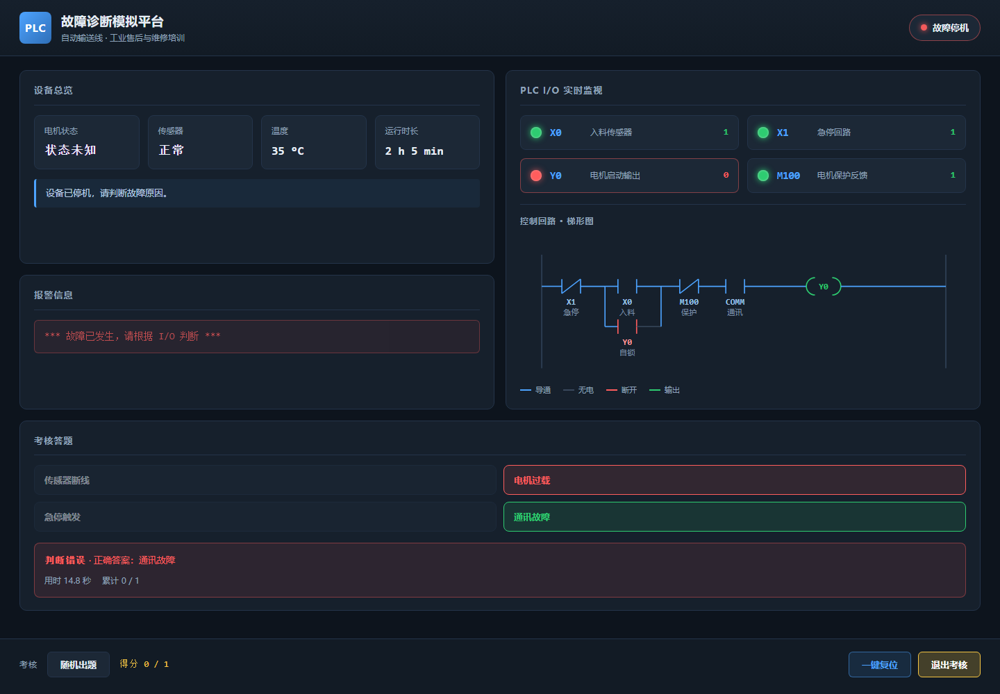

# PLC 故障诊断模拟平台 · 桌面版

自动输送线的故障诊断模拟与排故训练工具。可以实时查看 PLC 的 I/O 与梯形图，随时注入故障，也可以切到考核模式，让学员自己判断故障类型并自动判分。



## 背景

工业设备的售后培训一般要在真机上进行，但真机停机成本高，故障不容易复现，新人操作还有安全风险。

这个平台复刻了一条自动输送线的控制逻辑：4 类故障可以随时注入，I/O 状态和控制回路实时联动，同时给出报警码和排查步骤。另外有一个考核模式，报警码和诊断结论不下发给前端，学员只能根据 I/O 和梯形图判断，答完自动判分。

## 功能

### 实时状态监视

设备总览（电机状态、传感器、温度、运行时长）与 PLC I/O 指示灯：`X0` 入料传感器、`X1` 急停回路、`Y0` 电机启动输出、`M100` 电机保护反馈。

### 控制回路梯形图联动

标准起保停回路，每段导线的颜色取决于它前面所有触点的状态，故障时能直接看出断在哪一级：

```
|--[X1 急停]--+--[X0 入料]--+--[M100 保护]--[COMM 通讯]--( Y0 电机 )--
              +--[Y0 自锁]---+
```

| 故障 | 断开位置 | 现象 |
| --- | --- | --- |
| 传感器断线 | X0 触点 | 自锁无法建立，Y0 熄灭 |
| 电机过载 | M100 保护触点 | 保护反馈断开，温度升至 78 °C |
| 急停触发 | X1 急停触点 | 安全回路断开 |
| 通讯故障 | COMM 通讯使能 | I/O 全正常，但 PLC 禁止输出 |

### 故障注入

4 类典型故障，每类包含报警码、停机说明、可能原因与标准排查步骤。

### 考核模式

- 随机出题。报警码和诊断结论在服务端就被去掉了，`/api/status` 返回的数据里没有这些字段
- 设备总览里的「传感器断线」同时改成「异常」，否则一眼就能看出答案
- 学员根据 I/O 与梯形图判断故障类型，提交后立即判分并记录用时
- 考核期间手动注入接口、重复提交答案都会被服务端拒绝（400）




## 快速开始

### 方式一：下载即用（推荐）

到 [Releases](../../releases) 下载 `PLC故障诊断平台桌面版.exe`，双击运行。

- Windows 10 / 11，免安装、免 Python 环境
- 依赖 WebView2 运行时：Win11 自带；Win10 装了新版 Edge 即有

### 方式二：从源码运行

```bash
git clone https://github.com/ayybyw/PLC-Fault-Diagnosis-Simulator.git
cd PLC-Fault-Diagnosis-Simulator

python -m venv .venv
.venv\Scripts\activate
pip install -r requirements.txt

python app_main.py      # 桌面窗口
```

只跑后端、用浏览器看：

```bash
python app.py           # 然后打开 http://127.0.0.1:5000
```

### 重新打包 exe

```bash
python build.py         # 或双击 build.bat
```

产物在 `dist/PLC故障诊断平台桌面版.exe`。

## 测试

```bash
pip install -r requirements-dev.txt
pytest tests/ -v
```

20 个用例，覆盖首页渲染、静态资源、四类故障注入、复位、故障切换不残留，以及考核模式的答案隐藏、判分、重复提交拦截和考核期间禁止手动注入。

## 技术架构

```
┌──────────────────────────────────────────┐
│  pywebview 窗口（Edge WebView2）          │
│  index.html + script.js + style.css       │
│  · 1.5 s 轮询 /api/status                 │
│  · 梯形图 SVG 逐级带电推算                 │
└────────────────┬─────────────────────────┘
                 │ HTTP  127.0.0.1:5000
┌────────────────▼─────────────────────────┐
│  Flask 3.1（后台线程，werkzeug make_server）│
│  /api/status  /api/fault/<key>            │
│  /api/reset   /api/exam/{enter,start,answer,exit}
└──────────────────────────────────────────┘
```

几个实现上的说明：

- **界面用 WebView2**：打包后单文件 14 MB，Win11 自带运行时，不需要装 Node。同样效果的 Electron 方案通常 150 MB 起。
- **考核的答案在服务端裁**：只在前端隐藏的话，打开开发者工具就能看到。
- **梯形图用 SVG 实时绘制**：每段导线的颜色由上游所有触点的状态决定，用图片没法表达。
- **窗口尺寸按逻辑像素保存**：`GetWindowRect` 返回物理像素，高 DPI 下直接存会让每次启动的窗口放大 1.5 倍。

## 项目结构

```
.
├── app.py                 # Flask 后端：状态机、故障库、考核判分
├── app_main.py            # 桌面壳：启动服务 + WebView2 窗口 + 深色标题栏
├── templates/index.html   # 页面结构
├── static/
│   ├── script.js          # 轮询、梯形图渲染、考核交互
│   └── style.css          # 工业风深色主题
├── tests/                 # pytest 用例（基础接口 + 考核模式）
├── assets/app.ico         # 应用图标
├── runtime/               # 可选：原始字节码后端（兜底用，不提交也能正常运行）
├── tools/make_icon.py     # 图标生成脚本
├── build.py / build.bat   # 一键打包
├── screenshots/           # README 配图
├── requirements.txt
└── requirements-dev.txt
```

## 加一个故障

两处改动。

**1. `app.py` 的 `FAULTS` 字典**

```python
"vfd_overvoltage": {
    "name": "变频器过压",
    "alarm": "E302 · 变频器直流母线过压",
    "message": "变频器报 OU 故障，输出已封锁。",
    "motor": "故障停机",
    "temperature": 41,                       # 可选，不写则沿用正常值
    "io": {"X0": 1, "X1": 1, "Y0": 0, "M100": 1},
    "causes": ["减速时间过短，再生能量回馈", "制动电阻未接或损坏", "输入电压偏高"],
    "steps": ["查看变频器面板故障码", "测量直流母线电压", "检查制动单元", "延长减速时间后复位"],
},
```

**2. `static/script.js` 的 `FAULT_BUTTONS`**

```js
{ key: "vfd_overvoltage", label: "变频器过压" },
```

改完运行 `python build.py` 重新打包。字段含义写在 `app.py` 开头的注释里。

## 说明

- 本项目是教学模拟平台，不连接真实 PLC，所有状态均为软件仿真
- 故障现象与排查步骤参考常见工业现场经验，用于培训演示，不能替代设备手册
